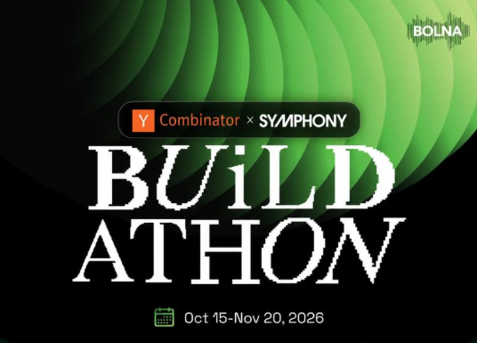
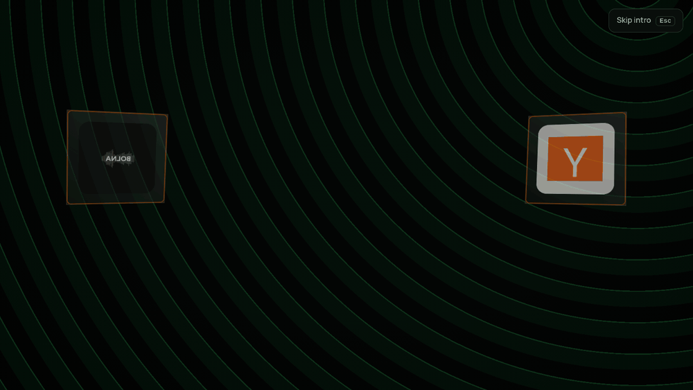
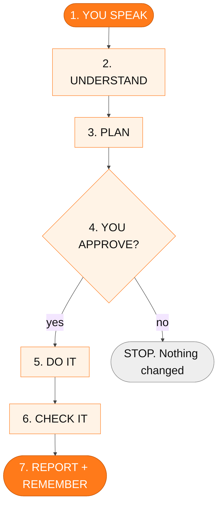
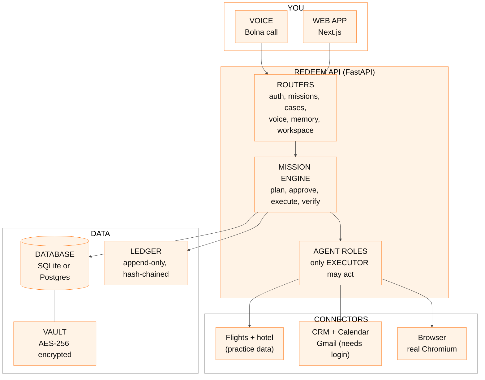
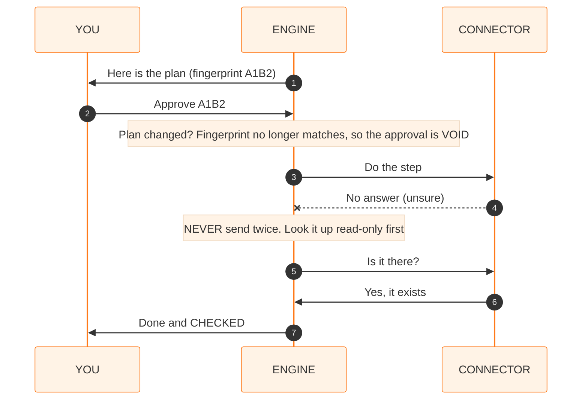
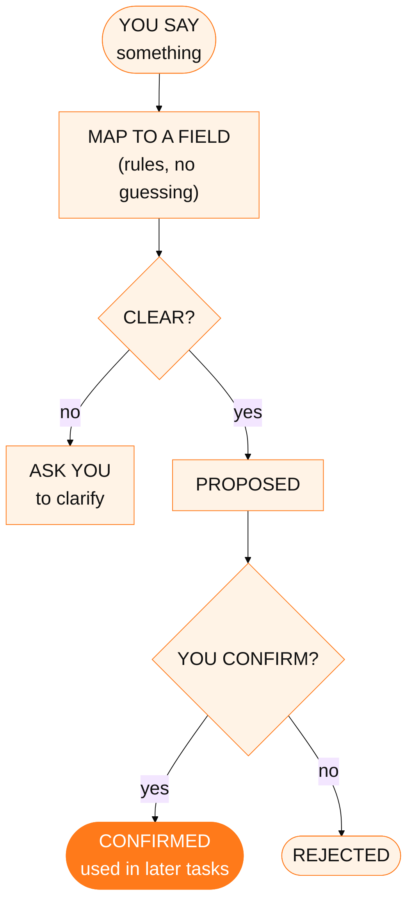
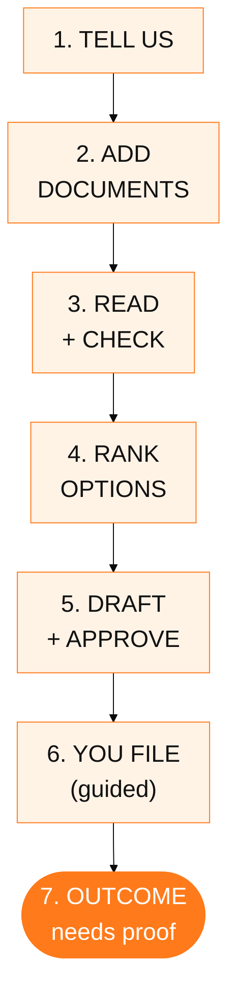

<div align="center">

# REDEEM

### Speak Your Need. <span style="color:#ff7a1a">We Take the Lead.</span>

<br/>



<br/><br/>

 &nbsp;&nbsp;&nbsp;&nbsp; 

<br/><br/>



<sub>The real intro of the app, recorded from the running UI (the app's <b>Replay intro</b> button plays it again).</sub>

</div>

<br/>

> **Built for the Y Combinator x Symphony Buildathon, run with Bolna (15 Oct to 20 Nov 2026, dates as printed on the banner).**
> **Try it now: press "Demo login" on the landing page.** Anyone can open a private demo workspace with practice data, no account needed.
> Parts that talk to outside services (live Bolna calls, Google Calendar/Gmail) switch on as soon as you add your own keys.
> Not endorsed by, sponsored by or affiliated with Y Combinator, Symphony or Bolna.

---

## 1. What is REDEEM, in plain words

You **say what you need** ("my flight was cancelled, get my money back"). REDEEM then:

1. **Understands** the request and the people, bookings and documents involved.
2. **Makes a plan** and shows it to you.
3. **Waits for your OK** on every step that changes something.
4. **Does the steps** through connectors.
5. **Checks the result itself** (it never trusts "sent" without looking).
6. **Remembers** what you told it, but only what you confirm.

It covers eight everyday areas: **travel, banking, insurance, telecom, shopping, housing, government complaints and healthcare paperwork.**

## 2. The big picture



**Why this matters:** nothing happens without your approval, and "done" only means done after REDEEM has checked it independently.

## 3. Architecture (what runs where)



| Block | Plain meaning |
|---|---|
| **Voice** | You talk through Bolna. Live calls need your Bolna credentials (not tested live, see limits). |
| **Mission engine** | One brain that runs every kind of task the same safe way. |
| **Agent roles** | Planner, observer, specialists, verifier, recovery, memory can only think; **only the executor can act.** |
| **Connectors** | The hands: each can *look up*, *submit* and *verify*. |
| **Ledger** | A diary nobody can edit afterwards; each line is chained to the one before. |
| **Vault** | Your private data is encrypted before it is stored. |

## 4. The safety rules, as one picture



- **Approval is tied to the exact plan.** Change anything and you must approve again.
- **Unsure is not success.** If the answer is lost, REDEEM looks the result up instead of repeating the action.
- **Your data stays yours.** Every query is limited to your own workspace; the identity comes only from your login session.

## 5. How memory works



Only **confirmed** memory is used, it is **encrypted**, and you can **correct or delete** it in the Memory Center and Privacy Center.

## 6. How a consumer case moves



REDEEM **never files anything for you.** It prepares, explains and guides. An outcome counts as "won" only when a supporting document shows it. Every cited rule is checked against the knowledge base, so nothing is invented.

---

## 7. What is real today

<!-- FEATURES:START (generated by scripts/sync_readme.py from registry/features.json) -->

✅ verified: 16 · 🟠 partial: 3 · ⛔ blocked (external): 1 · ⬜ not done: 4

| Feature | Status | Evidence | Origin |
|---|---|---|---|
| Mission engine: digest-bound approvals, hash-chained ledger, reconcile-not-resend, recovery | ✅ verified | apps/api/tests (backend suite) | REDEEM |
| 8 consumer-rights domains, 17-stage case lifecycle, citations, document intelligence | ✅ verified | tests/test_reclaim.py, tests/inherit.spec.ts | RECLAIM |
| Real Chromium on fixture apps: snapshots, temporal guard, user-only steps | ✅ verified | tests/test_resolve.py | RESOLVE |
| Live Engine: real run replayed from the stored ledger | ✅ verified | apps/web/tests/cinematic.spec.ts | REDEEM |
| Persistent encrypted memory with provenance, confirmation, correction, deletion, retention | ✅ verified | tests/test_memory.py, apps/web/tests/memory.spec.ts | REDEEM |
| Spoken answer -> structured field mapper (rule-based; EN/HI/Hinglish/TA/TE terms) with clarification on ambiguity | ✅ verified | tests/test_memory.py | REDEEM |
| Live Bolna calls | ⛔ blocked (external) | adapter + contract tests with mock transport only; needs Bolna credentials | REDEEM |
| Envelope encryption (AES-256-GCM): wrapped per-workspace keys, versions, DEK + KEK rotation, fail-closed in production | ✅ verified | tests/test_memory.py, tests/test_encryption.py | REDEEM |
| KMS integration / end-to-end encryption | ⬜ not done | KEK comes from environment; server can decrypt | REDEEM |
| PostgreSQL 16 support | ✅ verified | migrations 0001-0007, alembic check, full suite on Postgres 16 (run locally; Docker build untested) | REDEEM |
| REDEEM identity intro (3D cubes from left/right, orange tagline), skip/replay/reduced-motion | 🟠 partial | apps/web/tests/memory.spec.ts, skills_projects.spec.ts; Bolna and Y Combinator cubes show the official logo files | REDEEM |
| Official Bolna / YC / WeMakeDevs logo artwork | 🟠 partial | Bolna and Y Combinator official files embedded unmodified (apps/web/public/brand); WeMakeDevs artwork absent | REDEEM |
| Recorded browser skills (record by doing, parameterise, replay live with pause/resume/stop) | ✅ verified | apps/api/app/resolve/skills.py, tests/test_skills_projects.py, e2e skills_projects.spec.ts; runs on the local practice apps only; repair/edit of saved steps not built | RESOLVE |
| WebGL / three.js scenes | ⬜ not done | CSS 3D + canvas only | REDEEM |
| Context memory: per-user conversation turns (encrypted), short follow-ups inherit the previous request's entities | ✅ verified | tests/test_context.py, apps/web/tests/context.spec.ts | REDEEM |
| Unified per-user history timeline (missions, cases, calls, documents, memory, conversation, activity) with search and filters | ✅ verified | tests/test_context.py, apps/web/tests/context.spec.ts | REDEEM |
| Memory Graph: user, preferences, calls, missions, entities, cases, documents and their links (derived live, private) | ✅ verified | tests/test_context.py, apps/web/tests/context.spec.ts | REDEEM |
| Dedicated graph database / vector store | ⬜ not done | the graph is computed from relational rows; no Neo4j or embeddings | REDEEM |
| Real OCR (RapidOCR/ONNX) for images and scanned PDFs, with review and correction that recomputes facts | ✅ verified | tests/test_ocr.py, apps/web/tests/live.spec.ts | RECLAIM |
| Brief to PDF: extract structure, edit, render a real PDF stored encrypted with provenance | ✅ verified | tests/test_brief.py, apps/web/tests/live.spec.ts | RESOLVE |
| Google Calendar + Gmail: OAuth, encrypted tokens, refresh, revoke, approved idempotent actions, read-back verification, reconcile-not-resend | 🟠 partial | tests/test_integrations.py (11) against an in-process fake of Google's documented endpoints; a live test exists and is skipped without credentials | REDEEM |
| Demo fixtures separated from production: never seeded or runnable when REDEEM_ENV=production | ✅ verified | tests/test_integrations.py::test_production_mode_never_seeds_simulated_data_and_disables_demo_runs | REDEEM |
| DevOps, Science, Creative adapters; LLM abstraction; local speech-to-text | ⬜ not done | not ported; LLM needs a key, STT needs a model download | RESOLVE |
| Project Store (group missions, cases and documents) | ✅ verified | apps/api/app/api/skills_projects.py, tests/test_skills_projects.py (CRUD, IDOR, export), e2e | RESOLVE |

<!-- FEATURES:END -->

Honest accounting: [`docs/FINAL_FUNCTIONAL_COMPLETION_REPORT.md`](docs/FINAL_FUNCTIONAL_COMPLETION_REPORT.md), [`docs/REAL_INTEGRATION_STATUS.md`](docs/REAL_INTEGRATION_STATUS.md), [`docs/END_TO_END_EVIDENCE.md`](docs/END_TO_END_EVIDENCE.md), [`docs/TASKS_250_STATUS.md`](docs/TASKS_250_STATUS.md).

## 8. Tests

Backend and browser suites are described under *Run it*. Pass counts are only recorded here from a run that was actually executed (see the line below); nothing is claimed from memory.

- **Backend (`apps/api`, pytest): 246 passed, 1 skipped, 0 failed** in 313 s, run on this branch on 2026-10-31 (SQLite).
- Browser end-to-end (Playwright) and the web build: **not re-run for this README change**.

## 9. Run it

```bash
python -m venv .venv && . .venv/bin/activate && pip install -r apps/api/requirements.txt
cd apps/api && alembic upgrade head && uvicorn app.main:app --port 8000
```

```bash
cd apps/web && npm install && npm run build && npx next start -p 3000
```

Then open `http://localhost:3000`. Press **Replay intro** on the landing page to see the intro again.

```bash
cd apps/api && python -m pytest -q
cd apps/web && PW_CHROMIUM_PATH=/opt/pw-browsers/chromium npx playwright test
python scripts/sync_readme.py        # refresh the generated feature table
```

PostgreSQL 16 is supported (`scripts/dev_postgres.sh start`, then set `REDEEM_DATABASE_URL`). SQLite is the default.

## 10. What needs your keys or is out of scope

- **Live Bolna calls and live Google Calendar/Gmail** need your own credentials; they have not been run live without them.
- **No language model** is configured: the memory mapper and planners are rule-based.
- **No real filing, email, airline or bank.** Connectors use labelled practice data.
- No production-grade browser isolation, no KMS, no WebGL scene (CSS 3D + canvas), execution is synchronous, and the Docker build is untested.

Details: [`docs/OPEN_BLOCKERS.md`](docs/OPEN_BLOCKERS.md) · [`docs/MANUAL_ACTIONS_LATER.md`](docs/MANUAL_ACTIONS_LATER.md) · [`docs/IMPLEMENTATION_EVIDENCE.md`](docs/IMPLEMENTATION_EVIDENCE.md)

## 11. For contributors

