<div align="center">


### Speak Your Need. <span style="color:#ff7a1a">We Take the Lead.</span>

REDEEM turns a spoken request into a **planned, approved, executed and independently verified** outcome, across travel, banking, insurance, telecom, retail, housing, government and healthcare admin. It remembers what you tell it (privately, and only what you confirm).


</div>

## Partners and context

| | |
|---|---|
| **[Bolna](https://www.bolna.ai)** | Voice provider (the only live voice-call integration). No live call has been made without credentials. |
| **[Wispr Flow](https://wisprflow.ai)** | Shown in the intro as the second cube. |
| **[Y Combinator](https://www.ycombinator.com)** | Built for the Bolna × YC Symphony Buildathon 2026. |
| **[WeMakeDevs](https://www.wemakedevs.org)** | Event community. |

> Not endorsed by, sponsored by, or affiliated with any of the above. **Official logo artwork is not embedded**: the build sandbox could not reach those sites, and logos are never redrawn. Drop official files into [`apps/web/public/brand/`](apps/web/public/brand/README.md) and the intro cubes and this section can show them.

## The 3D emblem

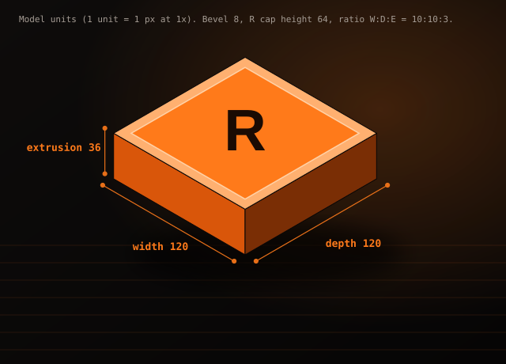 

Geometry is documented in the SVG (width 120, depth 120, extrusion 36, bevel 8; ratio 10:10:3), generated by [`scripts/build_readme_assets.py`](scripts/build_readme_assets.py). It is an isometric SVG render, not a WebGL model.

## See it

<details open>
<summary><b>Live Engine: a real run, replayed from its ledger</b></summary>


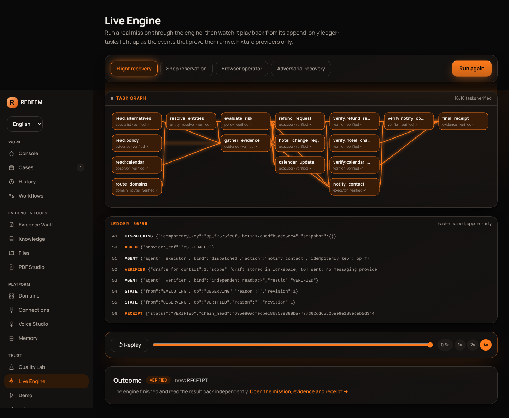

The run executes now on local fixtures; playback is read from the append-only, hash-chained event log. MP4: [`docs/media/live-engine.mp4`](docs/media/live-engine.mp4).
</details>

<details open>
<summary><b>Landing, Memory Center, Privacy Center</b></summary>

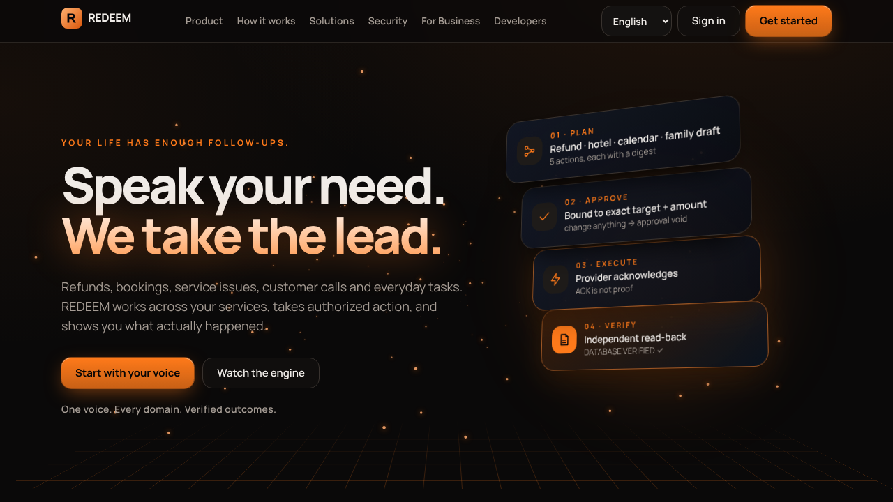

| Memory Center | Privacy Center |
|---|---|
| 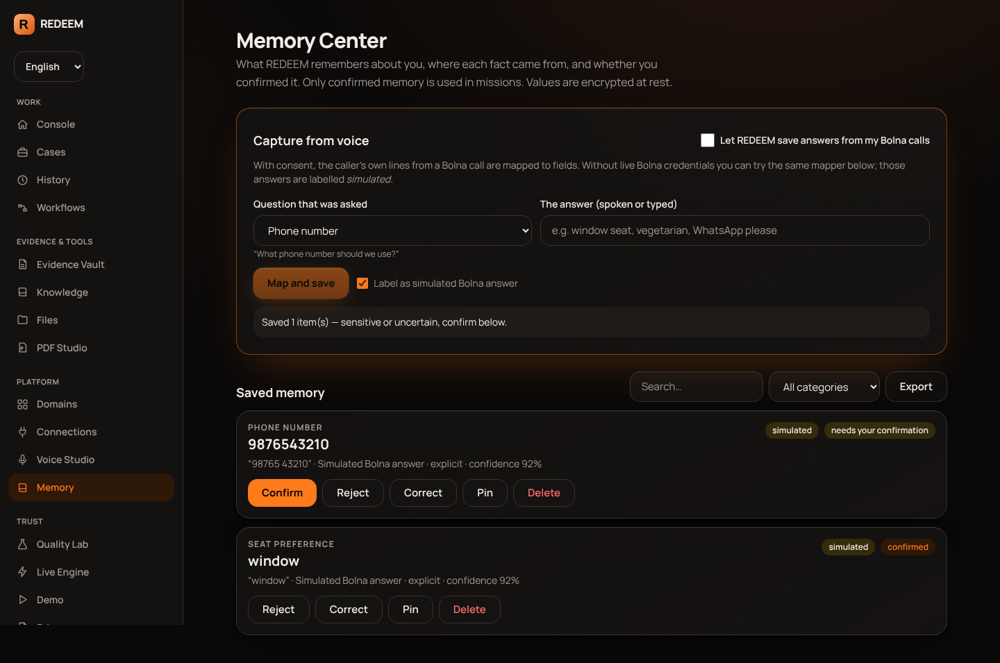 | 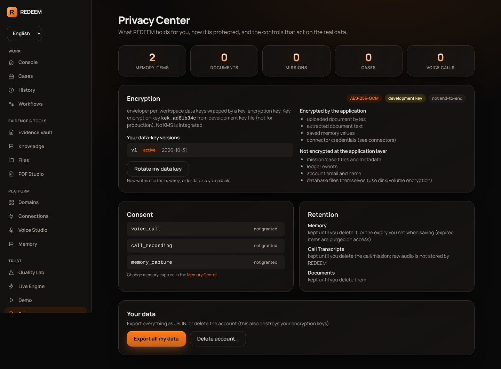 |
</details>

<details>
<summary><b>More screens</b></summary>

| Command Center | Cases |
|---|---|
| 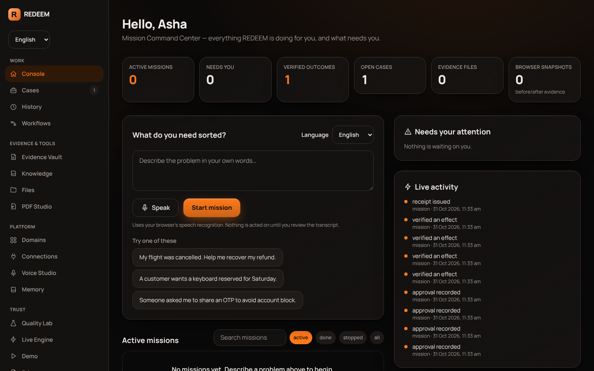 | 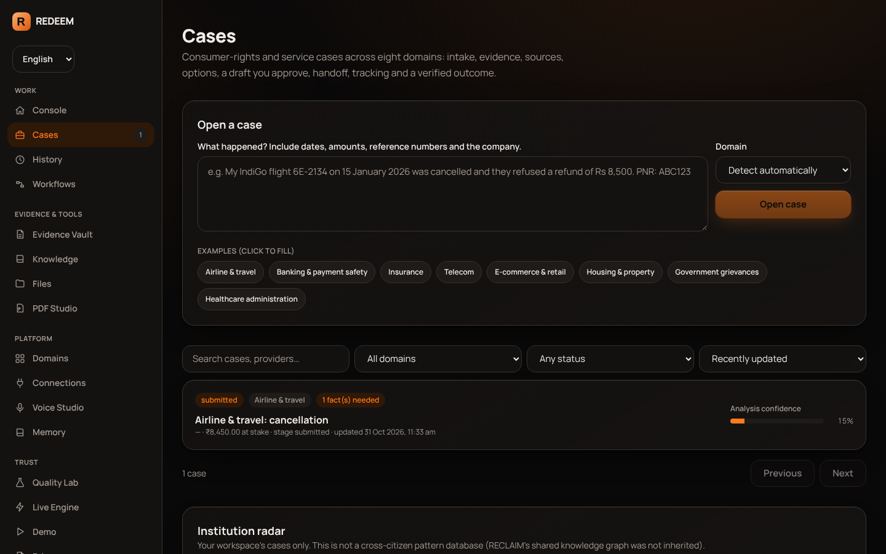 |
| **Evidence Vault** | **Domains** |
| 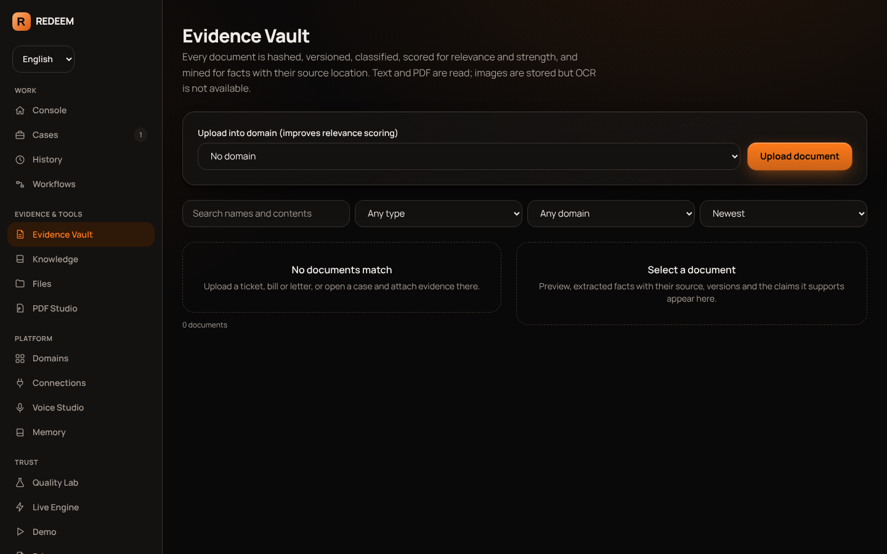 | 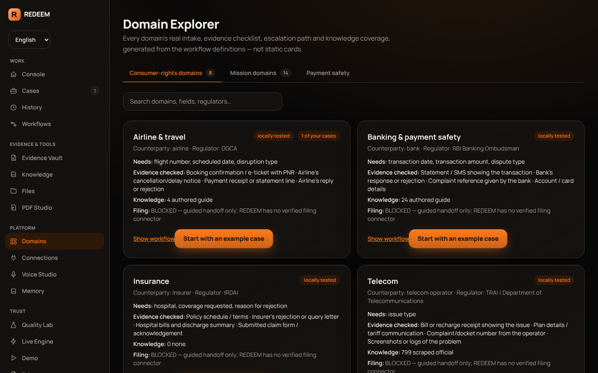 |
| **Voice Studio** | **Connections** |
| 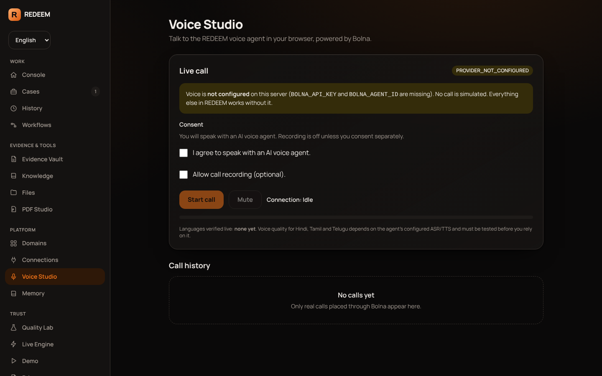 | 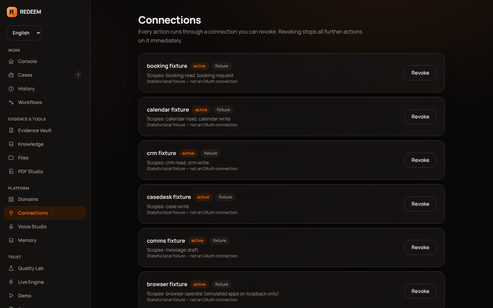 |

Full landing page: [`docs/screenshots/v3/landing-full.png`](docs/screenshots/v3/landing-full.png)
</details>

## What is real today

<details open>
<summary><b>Feature status (generated from <code>registry/features.json</code>)</b></summary>

<!-- FEATURES:START (generated by scripts/sync_readme.py from registry/features.json) -->

✅ verified: 8 · 🟠 partial: 1 · ⛔ blocked (external): 2 · ⬜ not done: 4

| Feature | Status | Evidence | Origin |
|---|---|---|---|
| Mission engine: digest-bound approvals, hash-chained ledger, reconcile-not-resend, recovery | ✅ verified | apps/api/tests (217 backend tests) | REDEEM |
| 8 consumer-rights domains, 17-stage case lifecycle, citations, document intelligence | ✅ verified | tests/test_reclaim.py, tests/inherit.spec.ts | RECLAIM |
| Real Chromium on fixture apps: snapshots, temporal guard, user-only steps | ✅ verified | tests/test_resolve.py | RESOLVE |
| Live Engine: real run replayed from the stored ledger | ✅ verified | apps/web/tests/cinematic.spec.ts | REDEEM |
| Persistent encrypted memory with provenance, confirmation, correction, deletion, retention | ✅ verified | tests/test_memory.py, apps/web/tests/memory.spec.ts | REDEEM |
| Spoken answer -> structured field mapper (rule-based; EN/HI/Hinglish/TA/TE terms) with clarification on ambiguity | ✅ verified | tests/test_memory.py | REDEEM |
| Live Bolna calls | ⛔ blocked (external) | adapter + contract tests with mock transport only; needs Bolna credentials | REDEEM |
| Envelope encryption (AES-256-GCM): wrapped per-workspace keys, versions, DEK + KEK rotation, fail-closed in production | ✅ verified | tests/test_memory.py, tests/test_encryption.py | REDEEM |
| KMS integration / end-to-end encryption | ⬜ not done | KEK comes from environment; server can decrypt | REDEEM |
| PostgreSQL 16 support | ✅ verified | migrations 0001-0007, alembic check, full suite on Postgres 16 (run locally; Docker build untested) | REDEEM |
| REDEEM identity intro (3D cubes from left/right, orange tagline), skip/replay/reduced-motion | 🟠 partial | apps/web/tests/memory.spec.ts; partner cubes show names because official logos could not be fetched | REDEEM |
| Official Bolna / Wispr Flow / YC / WeMakeDevs logo artwork | ⛔ blocked (external) | sandbox cannot reach the official sites; drop files into apps/web/public/brand/ | REDEEM |
| Recorded browser skills (record, edit, parameterise, replay, repair) | ⬜ not done | not ported from RESOLVE | RESOLVE |
| Brief-to-PDF, DevOps, Science, Creative adapters; Project Store; OCR; LLM abstraction; local STT | ⬜ not done | not ported; see docs/TASKS_250_STATUS.md | RESOLVE |
| WebGL / three.js scenes | ⬜ not done | CSS 3D + canvas only | REDEEM |

<!-- FEATURES:END -->

Honest accounting of the 250-task brief: [`docs/TASKS_250_STATUS.md`](docs/TASKS_250_STATUS.md).
</details>

<details>
<summary><b>Capabilities</b></summary>

- **Missions** (one engine): `flight_recovery`, `retail_reservation`, `crm_followup`, `case_preparation`, `browser_followup`. Approvals are digest-bound; stale approvals are void; lost acknowledgements are reconciled by read-only lookup, never blindly resent; pause / resume / reject / escalate; restart recovery; persisted task DAG; least-privilege agent roles (only `executor` dispatches).
- **Voice + memory**: Bolna agent tools `save_answer` and `recall`; spoken answers are mapped to structured fields; ambiguity yields a clarification; sensitive facts wait for your confirmation; only confirmed memory prefills later missions (recorded in the ledger as ids, not values).
- **Cases, evidence, knowledge**: see the RECLAIM section below.
</details>

<details>
<summary><b>RESOLVE inheritance</b></summary>

Inherited and tested: stateful fixture web apps, real Chromium runner (fresh context, request allow-list, before/after DOM/ARIA/screenshot/API hashes, user-only-step pause), temporal guard via approval digest, file worker (dedupe/dry-run/stale-plan guard/undo), PDF studio, utterance command interpreter, persisted task DAG.
**Not yet ported**: recorded browser skills, brief-to-PDF mission, DevOps/Science/Creative adapters, Project Store, local speech-to-text, OCR, LLM abstraction. See [`docs/FEATURE_INHERITANCE_MATRIX.md`](docs/FEATURE_INHERITANCE_MATRIX.md).
</details>

<details>
<summary><b>RECLAIM domain workflows</b></summary>

Eight domains (airline/travel, banking and payment safety, insurance, telecom, e-commerce/retail, housing, government grievance, healthcare administration), each with its own intake fields, evidence checklist, escalation ladder and knowledge coverage. A 17-stage persisted case lifecycle, BM25 retrieval with provenance and verified citations (nothing invented), document intelligence (facts to source quote/page), decision ranking with labelled assumptions, drafts bound to approvals, guided handoff (REDEEM never files for you), outcome VERIFIED only with a supporting document.
</details>

<details>
<summary><b>Architecture and multi-agent system</b></summary>

`apps/api/app/orchestration/engine.py` drives every domain; connectors expose `version_hash / snapshot / lookup / submit / verify`; roles in `agents.py` (planner, observer, specialists, executor, verifier, recovery, memory) are capability sets. Web: Next.js app router. Data: SQLAlchemy 2 + Alembic (0001–0007). Details: [`AGENTS.md`](AGENTS.md).
</details>

<details>
<summary><b>Bolna voice and persistent memory</b></summary>

- Session minting keeps the API key server-side; consent gate; call ledger; webhook confirmed by reading the execution back from Bolna. **Tested with a mock transport only; no live call has been made.**
- Memory items are database rows with provenance (source call id, transcript line, quote), explicit-vs-inferred, confidence, status (proposed / confirmed / rejected), optional expiry, pin. Capturing from calls needs your `memory_capture` consent. Answers made without live Bolna are labelled **simulated**.
- The mapper is rule-based (no LLM is configured): EN, Hindi/Hinglish, Tamil and Telugu terms for a fixed field registry, negation handled, unknown phrasing is never guessed.
</details>

<details>
<summary><b>Privacy and security</b></summary>

- **Envelope encryption (AES-256-GCM).** Per-workspace data keys are stored wrapped by a key-encryption key (env `REDEEM_MASTER_KEY`; previous keys in `REDEEM_MASTER_KEY_PREVIOUS`). Key ids and versions; tenant DEK rotation; KEK re-wrap; tamper and wrong-tenant detection; `REDEEM_ENV=production` refuses to start without a key. Encrypted: document bytes, extracted text, memory values and quotes. **Not encrypted at the application layer**: titles/metadata, ledger events, account email/name, the database files (use disk encryption). No KMS integration; **not end-to-end**: the server can decrypt while serving you.
- Deleting the account deletes the workspace's keys (crypto-shredding of leftover ciphertext).
- Tenant from the session only, an IDOR test per resource, argon2, HttpOnly cookie + CSRF, rate limits, SSRF guard, documents and web pages are data never instructions.
</details>

## Run it

```bash
python -m venv .venv && . .venv/bin/activate && pip install -r apps/api/requirements.txt
cd apps/api && alembic upgrade head && uvicorn app.main:app --port 8000
```

```bash
cd apps/web && npm install && npm run build && npx next start -p 3000
```

<details>
<summary><b>Database, tests, regenerating media</b></summary>

SQLite is the default. PostgreSQL 16 is verified (migrations, drift check and the full backend suite, run locally; the Docker build is untested):

```bash
scripts/dev_postgres.sh start
export REDEEM_DATABASE_URL=postgresql+psycopg://postgres@127.0.0.1:5433/redeem   # database must be UTF8
```

```bash
cd apps/api && python -m pytest -q                                              # backend (217)
cd apps/web && PW_CHROMIUM_PATH=/opt/pw-browsers/chromium npx playwright test  # browser E2E (38)
python scripts/sync_readme.py            # refresh the generated feature table (CI runs --check)
python scripts/build_readme_assets.py 217 38
```
</details>

<details>
<summary><b>Honest limits</b></summary>

No live Bolna call; no LLM; no OCR engine; no real filing, email, airline or bank; no production browser isolation; no WebGL scene (CSS 3D + canvas); Docker build untested; no KMS; execution is synchronous; official partner logos not embedded (see above). [`docs/OPEN_BLOCKERS.md`](docs/OPEN_BLOCKERS.md) · [`docs/MANUAL_ACTIONS_LATER.md`](docs/MANUAL_ACTIONS_LATER.md) · [`docs/IMPLEMENTATION_EVIDENCE.md`](docs/IMPLEMENTATION_EVIDENCE.md)
</details>

<details>
<summary><b>Contributing, licence, notices</b></summary>

Read [`AGENTS.md`](AGENTS.md) first (never fake a provider, tenant from the session only, never weaken a test, no secrets in git). Includes MIT-licensed code and data from RESOLVE and RECLAIM: [`THIRD_PARTY_NOTICES.md`](THIRD_PARTY_NOTICES.md). Reusable UX prompt: [`docs/CINEMATIC_UX_PROMPT.md`](docs/CINEMATIC_UX_PROMPT.md).
</details>
