<div align="center">

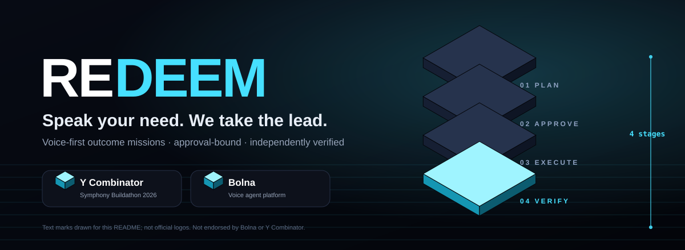

**Voice-first outcome missions: understand → plan → approve → execute → independently verify → receipt.**


</div>

> Built for the Bolna × YC Symphony Buildathon 2026. Not endorsed by Bolna or Y Combinator. The "Bolna" and "Y Combinator" tiles above are text marks, not official logos.

## See it

<details open>
<summary><b>Live Engine — run a real mission, watch it replay from its ledger</b></summary>

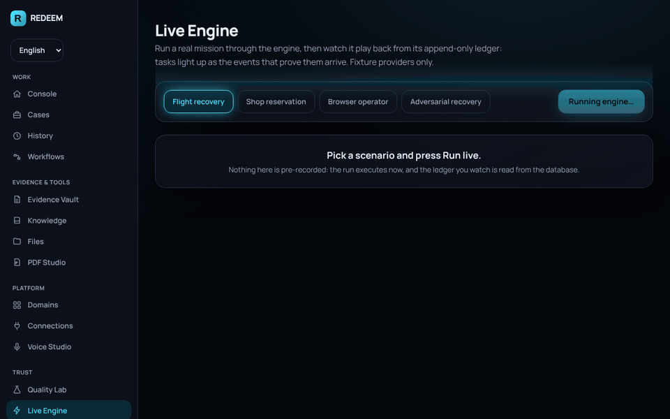

The run executes on demand against local fixtures; the playback is read from the append-only, hash-chained event log (`/live` in the console). Not pre-recorded. MP4: [`docs/media/live-engine.mp4`](docs/media/live-engine.mp4).

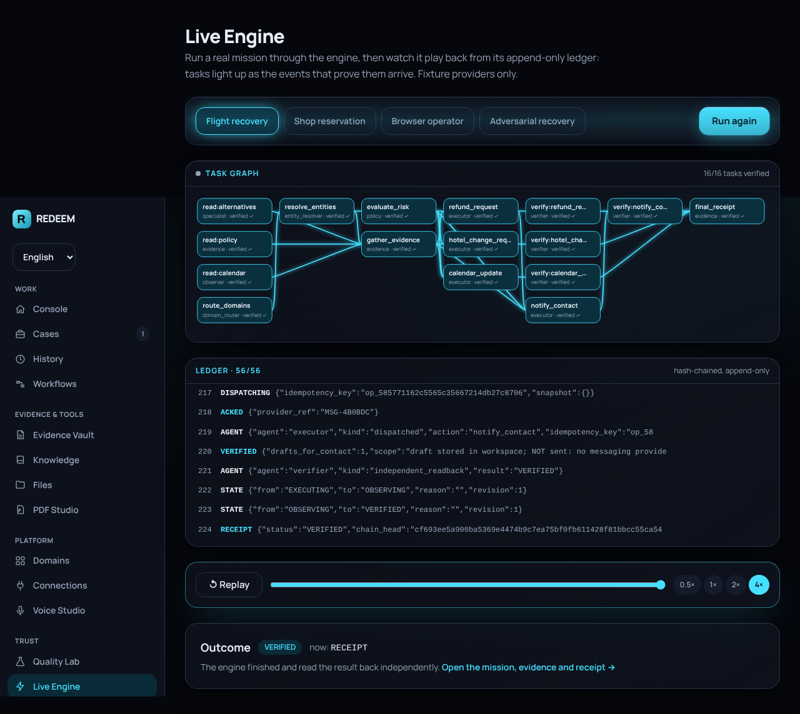
</details>

<details open>
<summary><b>Landing page</b></summary>

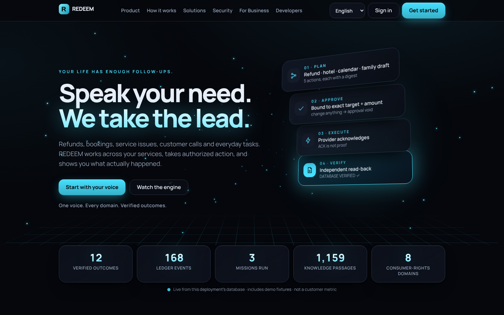

<details><summary>Full page and mobile</summary>

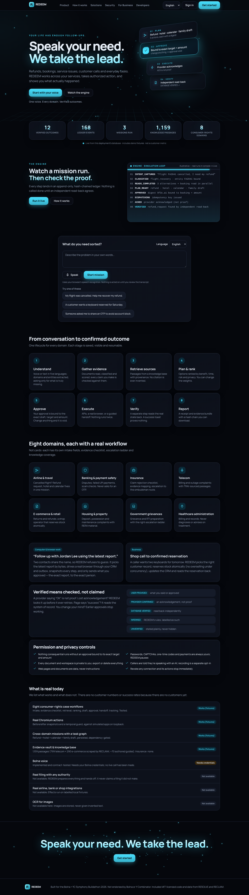 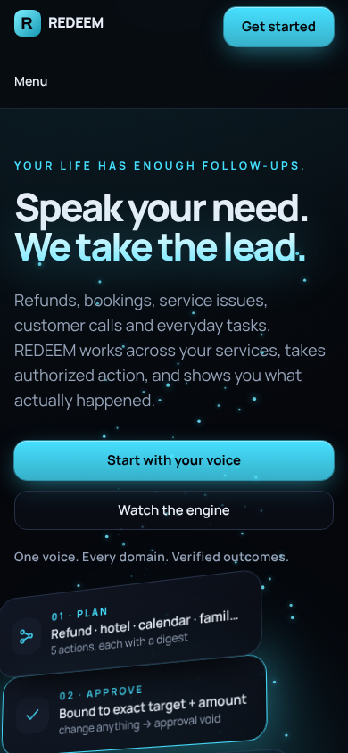
</details>
</details>

<details>
<summary><b>Console screens</b></summary>

| Command Center | Cases |
|---|---|
| 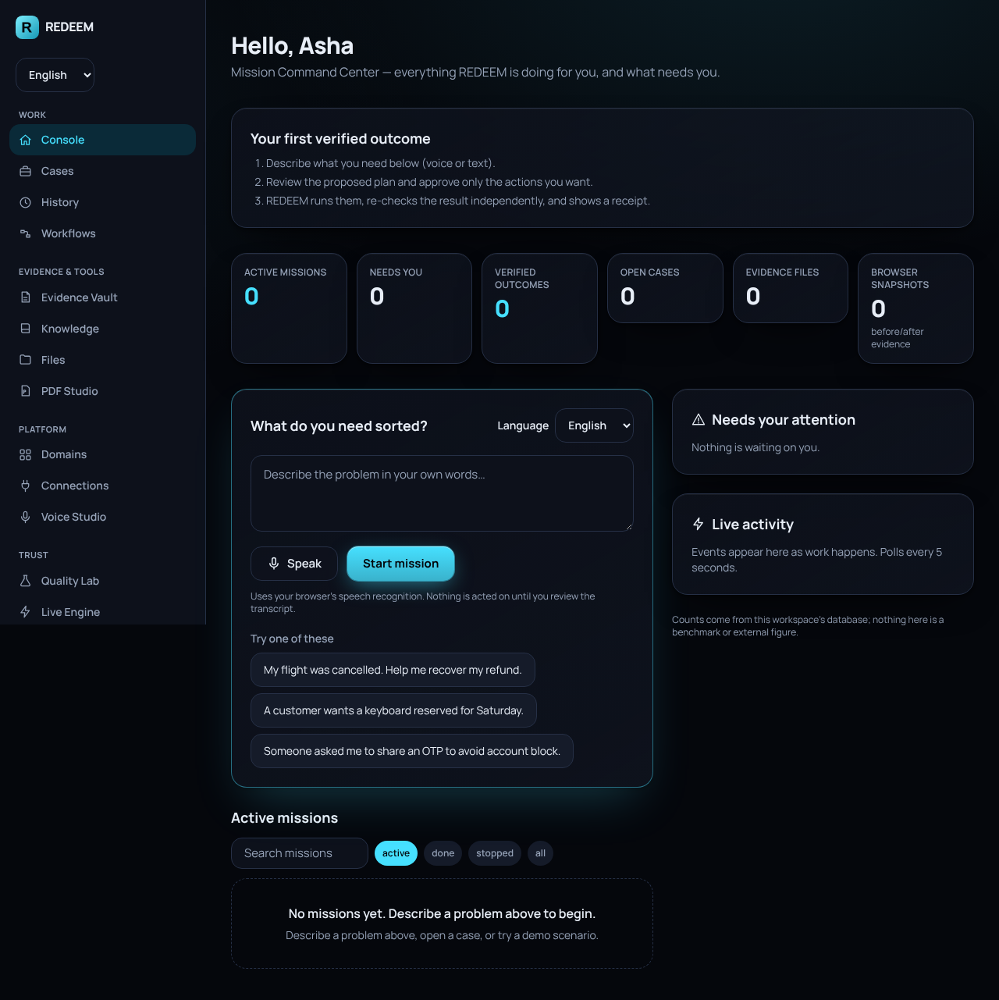 | 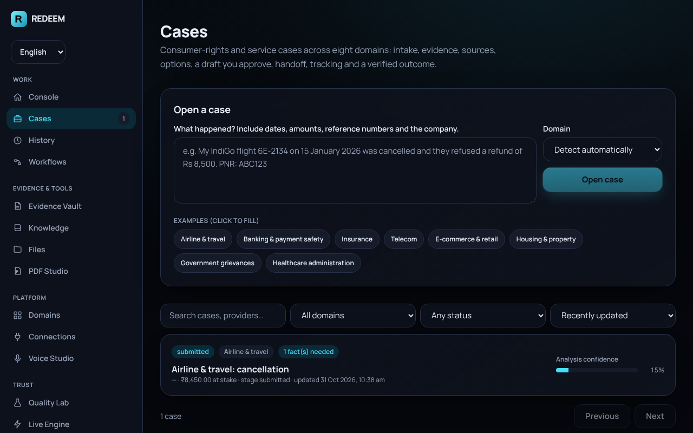 |
| **Evidence Vault** | **Domains** |
| 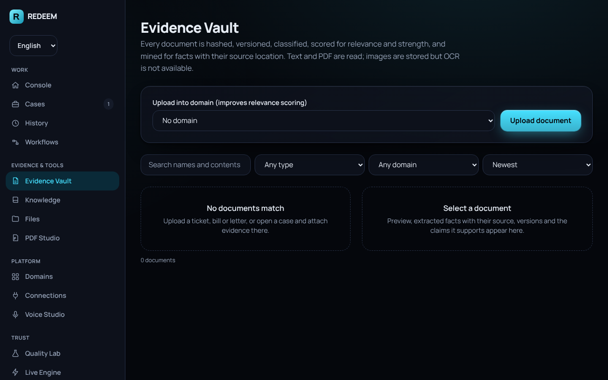 | 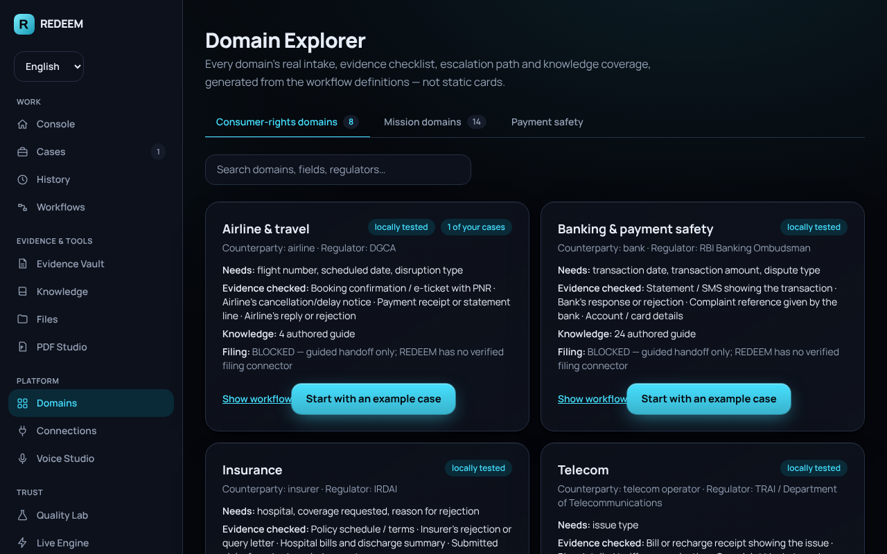 |
| **Quality Lab** | **Voice Studio** |
| 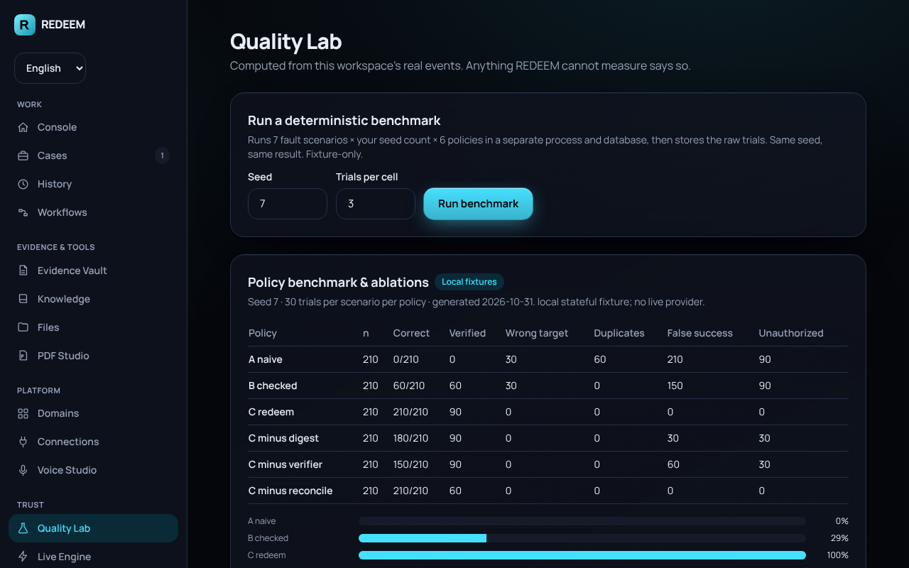 | 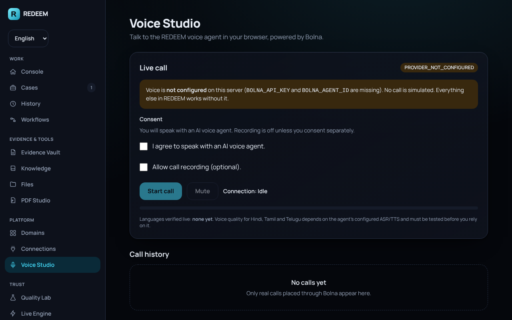 |
</details>

<details>
<summary><b>Measured numbers (3D)</b></summary>

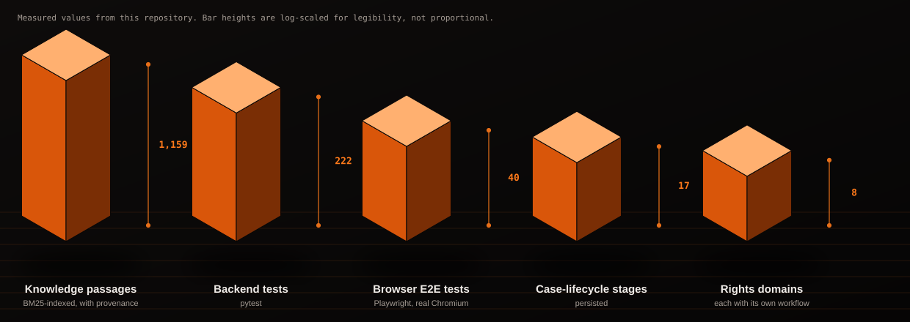

Values are measured from this repo; bar heights are log-scaled for legibility. There are no customer or success-rate figures because there are no customers.
</details>

## What it does

<details open>
<summary><b>Missions (one engine for every domain)</b></summary>

- `flight_recovery` (refund + hotel + calendar + family draft + travel case), `retail_reservation`, `crm_followup`, `case_preparation`, `browser_followup` (real Chromium on simulated apps).
- Approvals are digest-bound to the exact target and amount; stale approvals are void. Lost acknowledgements are reconciled by read-only lookup, never blindly resent. Append-only ledger with hash-chained receipts. Pause / resume / reject / escalate; restart recovery.
- Persisted task DAG; least-privilege agent roles (only `executor` can dispatch).
</details>

<details>
<summary><b>Consumer-rights cases (inherited from RECLAIM)</b></summary>

8 domains, 17-stage persisted case lifecycle, BM25 knowledge base with provenance and verified citations (nothing invented), document intelligence (facts → source quote/page), decision ranking with labelled assumptions, drafts bound to approvals, guided handoff (REDEEM never files on your behalf), outcome VERIFIED only with a supporting document. See [`docs/FEATURE_INHERITANCE_MATRIX.md`](docs/FEATURE_INHERITANCE_MATRIX.md).
</details>

<details>
<summary><b>Browser & computer work (inherited from RESOLVE)</b></summary>

Fresh Chromium context per run, request allow-list, before/after snapshots (DOM/ARIA/screenshot/API hashes), user-only-step pause (login/CAPTCHA/MFA), temporal guard (the report you approved is the report that is sent), file worker with dedupe / dry-run / stale-plan guard / undo, PDF studio.
</details>

<details>
<summary><b>Privacy and security</b></summary>

- **Encrypted documents.** File bytes: AES-256-GCM with a per-tenant HKDF key, tenant id bound as AAD (a blob moved to another tenant fails to decrypt). Extracted text in the database: AES-256-GCM (`enc1:` prefix). Tests assert that raw rows and files contain no plaintext. Master key: `REDEEM_MASTER_KEY`, else a `0600` file in the data dir. **Limit:** the server holds the key; this protects database dumps and disk copies, it is not end-to-end encryption.
- Tenant identity from the session only; every query filtered by tenant; an IDOR test per resource.
- argon2 passwords, HttpOnly cookie + CSRF, rate limiting, SSRF guard, documents and web pages are data and never instructions.
- `GET /api/v1/public/stats` is unauthenticated and aggregate-only (no tenant data).
</details>

<details>
<summary><b>Database</b></summary>

SQLAlchemy 2 + Alembic migrations 0001–0006 (`alembic check` is a test). **SQLite** is the zero-setup default; **PostgreSQL 16** is supported and verified: migrations apply cleanly, `alembic check` reports no drift, and the full backend suite (199 tests) passes against a real Postgres 16 server (run locally, not through Docker; the database must be UTF8).

```bash
scripts/dev_postgres.sh start        # throwaway Postgres on :5433, no Docker
export REDEEM_DATABASE_URL=postgresql+psycopg://postgres@127.0.0.1:5433/redeem
(cd apps/api && alembic upgrade head && python -m pytest -q)
```

`docker compose up` wires Postgres with a healthcheck and a data volume, but the Docker build itself is untested. `GET /api/v1/health` reports the active `dialect`. Set `REDEEM_MASTER_KEY` in production (documents are encrypted at rest).
</details>


## Run it

```bash
python -m venv .venv && . .venv/bin/activate && pip install -r apps/api/requirements.txt
cd apps/api && uvicorn app.main:app --port 8000
```

```bash
cd apps/web && npm install && npm run build && npx next start -p 3000
```

Open <http://localhost:3000>, create an account, then open **Live Engine** in the sidebar.

```bash
cd apps/api && python -m pytest -q                                   # backend
cd apps/web && PW_CHROMIUM_PATH=/opt/pw-browsers/chromium npx playwright test   # real-browser E2E
python scripts/build_readme_assets.py <backend_tests> <e2e_tests>    # regenerate the 3D SVGs
```

Screenshots/GIFs are regenerated from the running app (Playwright screenshots → `ffmpeg`).

<details>
<summary><b>Honest limits</b></summary>

No live Bolna call has been made (without credentials the UI shows `PROVIDER_NOT_CONFIGURED`); no LLM; no OCR engine; no real filing, email, airline or bank; no production browser isolation; Docker build untested (Postgres itself is verified); execution is synchronous; the landing-page "simulation loop" is illustrative and labelled as such. Details: [`docs/OPEN_BLOCKERS.md`](docs/OPEN_BLOCKERS.md), [`docs/MANUAL_ACTIONS_LATER.md`](docs/MANUAL_ACTIONS_LATER.md), [`docs/IMPLEMENTATION_EVIDENCE.md`](docs/IMPLEMENTATION_EVIDENCE.md).
</details>

<details>
<summary><b>Docs index</b></summary>

[`AGENTS.md`](AGENTS.md) · [`IMPLEMENTATION_STATE.md`](IMPLEMENTATION_STATE.md) · [`docs/FEATURE_INHERITANCE_MATRIX.md`](docs/FEATURE_INHERITANCE_MATRIX.md) · [`docs/IMPLEMENTATION_EVIDENCE.md`](docs/IMPLEMENTATION_EVIDENCE.md) · [`docs/CINEMATIC_UX_PROMPT.md`](docs/CINEMATIC_UX_PROMPT.md) (reusable prompt for this style of UX) · [`THIRD_PARTY_NOTICES.md`](THIRD_PARTY_NOTICES.md)
</details>
